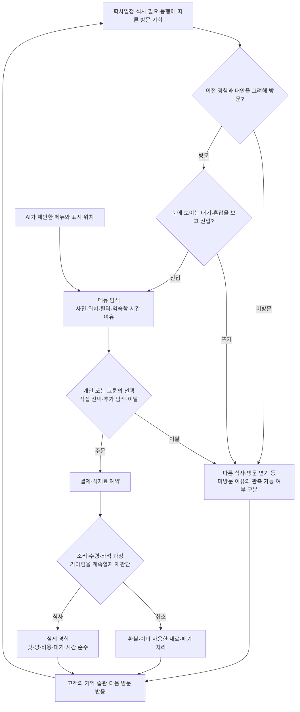

# 고객 행동·운영 현실성을 위한 최종 연구 및 설계 권고

최종 정리: 2026-11-07, Asia/Seoul. 대상: 대학 푸드코트의 메뉴 직접 추천 PPO Actor–Critic 시뮬레이션.

상태: 문헌 조사와 현재 구현 점검에 따른 **설계 권고안**이다. 아래 제안이 모두 구현됐다는 뜻은 아니다. 기준 코드 커밋은 `785c8ca10836574f0ece74a472d738bd3a435b5f`이다. 기존 실험·코드·보상계수는 이 조사로 변경하지 않았다.

## 1. 최종 판단

현실성을 높이는 핵심은 복잡한 고객을 더 많이 생성하는 것이 아니라, **실제 관측과 맞는 행동 과정을 만들고, 자료로 정하지 못한 부분은 여러 모형으로 나누어 검증하는 것**이다. 코드 검사 통과와 현실에서의 행동 재현은 별도 단계다. [Sargent의 검증 구분](https://www.informs-sim.org/wsc04papers/004.pdf)

현재는 구조·운영 가정을 탐색하는 연구용 환경이다. 실제 고객의 메뉴 선택·탐색·이탈 기록으로 보정한 모형은 아니다. 따라서 지금 가능한 주장은 ‘가정한 조건에서 AI 효과가 어떻게 달라지는가’이며, 실제 고객 만족도 향상은 아직 입증하지 않았다.

우선순위는 다음과 같다.

1. **고객 생성·선택·추천 반응을 개선:** 공동 특성, 제한 탐색, 여러 선택 규칙, 추천이 탐색에 미치는 영향.
2. **외부 수요·예산과 운영 상태를 분리:** 설비나 가격을 바꾸었다고 손님 수와 지갑이 자동으로 함께 바뀌지 않게 한다.
3. **단계별 이탈과 실제 병목을 반영:** 줄 진입 전, 주문 전, 결제 후의 행동과 식사·좌석·조리 과정을 구분한다.
4. **다른 날·다른 시설·다른 행동 모형에서 검증:** 계수만 바꾼 같은 세계를 반복하는 수준을 넘는다.
5. 실제 자료가 들어오면 가장 민감한 가정부터 보정한다. 근거 없이 기능을 많이 추가하는 것을 현실성의 증거로 삼지 않는다.

## 2. 프로젝트의 두 불확실성을 분리해야 한다

| 구분 | 질문 | 기호 | 다루는 방식 |
|---|---|---|---|
| 고객·운영 모형 | 실제 사람과 푸드코트는 어떻게 움직이는가? | φ | 실제 행동 자료로 보정하고, 남는 불확실성은 여러 세계로 시험 |
| 평가함수 | 어떤 결과를 얼마나 좋다고 볼 것인가? | ω | 현재 구상처럼 계수·함수 형태를 샘플링하고 후보별 효과 보관 |
| 추천 AI | 현재 상태에서 무엇을 추천할 것인가? | θ | 각 평가함수에 맞는 신경망을 여러 환경에서 학습 |

평가함수마다 AI를 따로 학습하는 구조를 유지한다. 각 AI는 다양한 푸드코트를 경험한다. **고객 행동 모형의 계수와 평가함수의 계수를 같은 것으로 만들지 않는다.** 고객의 행동은 결과를 만들고, 평가함수는 그 결과를 평가한다.

행동을 생성하는 데 확률적 효용식이나 규칙을 사용해도 추천 AI를 다시 사람이 정한 가중합 추천기로 바꾸는 것은 아니다. 추천은 계속 신경망이 메뉴를 직접 선택한다.

이후 설문은 만족도 지표가 사람의 반응과 어떻게 연결되는지 검증하는 데 도움이 된다. 다만 고객과 매장 사이의 비중 λ 같은 이해관계의 절충은 자료만으로 유일한 정답이 생기는 문제가 아니다. 관계자들이 선택할 평가 기준이라는 점을 함께 남겨야 한다.

## 3. 현재 구현에서 먼저 확인한 위험

아래는 문헌의 일반 주장이 아니라 **현재 코드에서 확인한 사실과 그에 대한 분석**이다.

| 현재 구현 | 현실성과 해석에 생기는 위험 | 우선순위 |
|---|---|---|
| 취향·예산·가격 민감도·대기 민감도를 상당 부분 독립 생성 | 시간 부족과 대기 민감도, 예산과 가격 민감도의 결합을 놓칠 수 있음 | P0 |
| 모든 고객이 같은 가산적 효용식과 잡음으로 선택 | 습관·조건 우선·충분히 좋은 메뉴를 고르는 행동을 같은 계수 변화로만 표현 | P0 |
| 직접 탐색 메뉴를 무작위로 뽑아 제한 | 실제 메뉴판 순서·사진·검색·익숙함을 반영하지 못함 | P0 |
| AI는 전체 후보를 보고 고객은 일부만 탐색 | 총 도입 효과에 메뉴 노출 확대와 학습 효과가 함께 들어감. 그 자체가 오류는 아니지만 원인 분해가 필요 | P0 |
| 추천 수용을 처음 탐색한 메뉴와의 효용 차이에 연결 | 이미 고민한 대안보다 나쁜 추천도 수용할 수 있음. 수용·거절과 탐색 과정의 연결이 단순함 | P0 |
| 고객 예산을 해당 메뉴 중앙 가격의 0.8~1.6배로 생성 | 초기 합성 규모 조정으로는 가능하나 가격 정책 실험에서 고객 지갑까지 함께 바뀌는 혼동 가능 | P0 |
| 잠재 수요를 조리능력×부하로 생성 | 부하 시험에는 유용하지만, 설비 변경 효과를 볼 때 방문 수까지 재생성하면 인과효과가 섞임 | P0 |
| 실제 줄 중간 포기는 키오스크 대기에 주로 적용 | 결제 뒤 조리·좌석 대기가 길어져도 손님이 끝까지 남는 방향으로 결과가 치우칠 수 있음 | P0 |
| 매일 새 고객, 반복 방문·경험 기억 없음 | 현재 추천의 장기 고객 반응을 충분히 학습·평가하지 못함 | P1 |
| 메뉴마다 단일 조리 자원을 일정 시간 점유, 좌석은 개인 단위 | 공용 장비·배치 조리·그룹 좌석·자리 선점에 따른 병목을 단순화 | P1 |
| 재고 만료·입고는 하루 시작에 처리하고 대기열은 당일 정리 | 시각별 유통·긴 주문 잔량·실제 폐점 규칙은 재현하지 못함 | P1/적용 범위에 따름 |
| 합성 학습·시험 시설은 다르지만 원출처 사례는 공유 | 실제로 다른 시설 원형에 대한 이전 성능을 입증한 것은 아님 | P0 |
| 구매하지 않은 고객의 취향·가격·대기 점수는 0 | 방문자 서비스 점수의 정의가 될 수 있으나 실제 주관적 불만족 0점의 관측값은 아님 | P0 |

코드 위치: `environment.py`의 고객 생성·탐색·수용·대기 이벤트, `study.py`의 예산 생성·달력 운영, `venues.py`의 용량 기반 수요, `inventory.py`의 일 단위 재고 처리. 이 위험이 실제 효과를 얼마나 바꾸는지는 추가 실험이 필요하다. 현재 AI 효과가 반드시 과장됐거나 반드시 작다고 단정하지 않는다.

## 4. 문헌에서 확인한 핵심과 적용 한계

### 4.1 사람마다 중요하게 여기는 조건과 대체 선택이 다르다

Mixed Logit은 개인별 선호 차이, 선택지 사이의 대체 관계, 시간에 걸친 미관측 요인의 관련성을 표현할 수 있다. 이는 서로 독립적인 민감도 몇 개만 뽑는 것보다 넓은 행동을 다룰 방법론적 근거다. 다만 적절한 변수와 자료로 추정해야 하며 이 모형을 선택했다고 현실성이 자동 확보되는 것은 아니다. [Train, 2009, 6장](https://eml.berkeley.edu/books/choice2nd/Ch06_p134-150.pdf)

**우리 설계 제안:** 기본 선택 모형은 제한 탐색을 결합한 혼합 선택 모형으로 두되, 습관형·충분조건형·특정 조건 우선형을 별도 대안 모형으로 시험한다. 모형 비중과 계수는 실측 전까지 가정이다.

### 4.2 고려한 메뉴와 좋아하는 메뉴를 구분해야 한다

선택 모형에서는 모든 대안을 다 검토한다는 가정을 완화할 수 있다. 고려 집합과 선호를 구분하는 연구는 이 둘을 한 과정으로 섞지 않을 이유를 제공한다. 해당 실증은 호텔·보험 등으로 우리 푸드코트의 탐색 수를 직접 정해주지는 않는다. [Abaluck·Adams-Prassl의 연구](https://academic.oup.com/qje/article/136/3/1611/6169736)

**우리 설계 제안:** 메뉴판의 위치·업종 필터·익숙함·남은 시간에 따라 메뉴를 발견하는 과정을 만들고, 고객이 실제 본 메뉴 안에서 선택하도록 한다. AI 추천도 우선 이 고려 집합과 주목 확률을 바꾼다.

### 4.3 메뉴가 많다고 언제나 만족도가 떨어지지는 않는다

선택 과부하 메타분석에서는 평균 효과가 거의 0에 가까웠지만 연구 간 차이가 컸다. 따라서 메뉴 수가 증가하면 일률적으로 혼란·불만족이 증가하도록 만드는 것은 근거가 부족하다. [Scheibehenne 등, 2010](https://scheibehenne.de/ScheibehenneGreifenederTodd2010.pdf)

**우리 설계 제안:** 낯선 고객·시간이 부족한 고객에게 탐색 부담이 커지는 조건뿐 아니라, 익숙한 고객에게 변화가 거의 없거나 선택 다양성이 도움이 되는 조건도 포함한다. 탐색시간과 선택 품질의 관계는 검증할 가정이다.

### 4.4 메뉴판 순서 자체도 효과를 낼 수 있다

스웨덴 대학 식당의 메뉴 순서 무작위 실험에서는 전체 선택에 영향이 있었지만 학생 카드 이용자에 대한 효과는 통계적으로 유의하지 않았다. 같은 개입도 고객 집단별 반응이 다를 수 있다. 세 가지 점심 메뉴의 현장 결과를 우리 다중 매장 키오스크의 효과 크기로 옮기지 않는다. [Andersson·Nelander, 2021](https://doi.org/10.3390/g12010002)

**우리 설계 제안:** 화면 배치 효과와 추천 알고리즘 효과를 별도 대조군으로 분해한다. 추천이 눈에 잘 보였다는 사실만으로 학습의 우월성을 주장하지 않는다.

### 4.5 대기는 이탈·재방문·식사시간에 함께 연결될 수 있다

인도 한 음식점의 실제 거래 연구에서는 긴 대기가 이탈, 더 늦은 재방문, 짧은 식사시간과 관련됐다. 관측 자료와 시뮬레이션을 결합한 연구지만 한국 대학 푸드코트의 인과계수나 인내시간 범위를 제공하지는 않는다. [de Vries 등, 2018](https://repub.eur.nl/pub/106497)

**우리 설계 제안:** 예상·체감·실제 대기를 구분하고, 결제 전후의 다른 행동과 이후 방문 반응을 따로 관측·보정한다. 주문을 끝낸 손님이 무한히 기다리는 가정은 피한다.

### 4.6 동행인과 주변 사람을 완전히 독립으로 보기 어렵다

대학 캠퍼스의 구매 연구는 줄에서 앞사람이 구매한 추가 품목을 따라 사는 행동을 분석했다. 이는 사회적 영향의 근거지만, 추가 품목에 대한 관측 효과를 주메뉴 전체나 한국 학생의 동행 효과 수치로 사용하면 안 된다. [Gligorić 등, 2024](https://www.microsoft.com/en-us/research/publication/food-choice-mimicry-on-a-large-university-campus/)

**우리 설계 제안:** 동행 도착·같은 식사시간·그룹 좌석 요구를 포함하는 모형과 독립 고객 모형을 비교한다. ‘앞사람을 항상 따라 산다’ 같은 고정 규칙은 쓰지 않는다.

### 4.7 도착·서비스 분포는 데이터로 고르는 것이 좋다

캠퍼스 속성 음식점의 관측 연구는 주문·업무별 시간을 나누고, 흔한 분포가 맞지 않는 도착 자료에는 경험분포를 사용했다. 이 사례의 수치보다 관측→분포 적합→별도 검증의 절차가 중요하다. [Curin 등, 2005](https://informs-sim.org/wsc05papers/331.pdf)

**우리 설계 제안:** 학교 시간표·메뉴·요일별 주문 기록이 있으면 먼저 도착 시계열을 재현한다. 수요를 반드시 포아송, 조리시간을 반드시 하나의 로그정규분포로 고정하지 않는다.

## 5. 권장 고객 행동 구조

다음은 **제안 구조**이며 모든 화살표가 현재 구현된 것은 아니다.



### 5.1 안정적인 특성과 당일 상태를 나누기

- 안정적인 특성: 선호 음식·피해야 할 재료·가격 민감도·평소 익숙한 매장. 반복 방문에서 유지한다.
- 당일 상태: 배고픔·남은 시간·오늘 예산·최근 먹은 메뉴·동행·날씨·수업 일정. 상황에 따라 달라진다.
- 공동분포: 당일 시간 여유와 대기 민감도, 예산과 가격 민감도를 관련 있게 생성할 수 있어야 한다. 관련성의 방향·크기는 자료로 정하거나 가정으로 표시한다.
- 입력과 속마음: 고객이 선택한 5단계 입력은 실제 선호의 정확한 관측값이 아니다. 누락·잘못된 입력·응답 오차를 시험한다.
- 같은 사람의 입력이 매번 완전히 무관하게 바뀌거나, 비싼 메뉴가 추가됐다고 지갑이 자동 커지는 구조는 피한다.

### 5.2 필수조건과 선호 구분

알레르기·명시적 금지·품절은 후보 제외 조건이다. ‘가격이 중요하다’는 선호와 ‘7,000원을 초과하면 주문하지 않는다’는 제한은 다르다. 실제 적용에 필요한 원재료 정보가 불확실하면 알고리즘이 안전하다고 추정해 채우지 않는다. 모형의 가상 알레르기 태그를 실제 성분표로 사용하지 않는다.

### 5.3 추천을 ‘수용 동전 던지기’ 하나로 끝내지 않기

권장 기본안은 추천을 본 메뉴 집합·주의·기대에 반영한 뒤, 고객이 다른 대안과 함께 다시 선택하도록 하는 것이다. 별도 수용 확률 모형을 쓴다면 고객이 실제 고려 중인 대안·과거 추천 경험·노출 여부와 연결하고 관측 로그로 검증한다.

추천을 좋아하는 반응, 거의 무시하는 반응, 방해로 느끼는 반응을 별도 가정으로 시험한다. 그 비중을 현실의 비중이라고 부르지 않는다. 추천이 항상 좋아지는 방향으로 규칙을 맞추지 않는다.

### 5.4 여러 선택 모형을 남겨두기

| 행동 모형 후보 | 재현하려는 행동 | 검증할 관측 |
|---|---|---|
| 제한 탐색 + 혼합 확률 선택 | 개인차와 같은 계열 메뉴의 대체 | 메뉴별 점유율·품절 후 대체·가격 반응 |
| 충분조건 선택 | 기준을 만족하는 메뉴를 찾으면 탐색 종료 | 탐색 수·소요시간·선택 변경 |
| 조건 우선 선택 | 시간 제한이나 가격 조건을 먼저 해결 | 시간 부족·가격 변화 때의 선택 |
| 습관·경험 기반 선택 | 익숙한 메뉴 반복, 나쁜 경험 뒤 변화 | 반복 구매·방문 간격·동일 고객의 변화 |

모형을 늘리는 목적은 어느 하나를 정답으로 선언하기 위해서가 아니라, 특정 고객 법칙에만 맞춘 AI인지 확인하기 위해서다. 실제 자료가 충분하면 모형 선택·혼합 비중을 예측력으로 비교한다.

## 6. 운영 과정에서 현실성을 좌우하는 부분

### 6.1 외부 수요와 내부 능력

관측 수요를 쓸 수 있으면 고객 기회·도착은 시간표·식사시간·행사·날씨·주변 대안 등에 연결한다. 용량×부하는 스트레스 설계로 별도 남긴다. 같은 수요를 둔 채 조리 인력이나 키오스크만 바꾸는 실험이 가능해야 한다.

현재 예산의 메뉴 가격 비례 생성도 초기 규모 조정 가정으로 한정한다. 실제 가격 개입을 평가할 때는 고객의 예산·식권·잔액·허용 지출을 독립적으로 유지하고 가격만 바꿔야 한다.

### 6.2 관측되는 대기와 실제 대기

사람은 미래의 정확한 조리 완료시각을 알지 못한다. 보이는 줄·안내된 시간·과거 경험으로 기다림을 예상한다. AI에 더 정확한 정보가 있다면 어떤 정보인지 구분해 기록한다. 정보 접근의 이득과 추천 최적화의 이득을 분리해 해석한다.

이탈은 최소한 진입 전·줄 대기·주문 결정·결제 이후를 구분한다. 결제 후 취소는 실제 환불·재료 예약 해제·이미 조리한 음식 처리와 연결한다. 영업 종료 뒤의 잔여 주문도 무조건 완료하거나 무조건 다음 날로 넘기지 말고 실제 규칙을 반영한다.

### 6.3 병목과 그룹

관측으로 병목이 확인되는 순서대로 주문·결제·조리·배식·좌석을 나눈다. 필요할 때 공용 튀김기·밥솥·포장대·배치 조리와 직원의 역할 차이를 추가한다. 메뉴마다 조리자 한 명을 통째로 점유하는 방식이 실제 흐름과 맞는지 확인한다.

좌석은 개인별 숫자뿐 아니라 동행 규모·테이블 크기·자리 선점·포장 여부에 따라 달라질 수 있다. 모든 시설에 동일한 복잡한 규칙을 넣기보다 관측된 시설 운영형을 선택한다. 기본 대상이 대학이므로 공항의 24시간 정밀 모형을 먼저 완성하는 것은 우선순위가 낮다.

### 6.4 재고·배송·폐기

자료가 들어오면 원재료를 실제 공유·대체 관계에 맞게 나눈다. 만료·입고의 시각 단위가 추천에 영향을 준다면 현재 일 단위 처리를 세분화한다. 공급업체가 알려준 납품 예정과 미래 실제 지연은 구분한다.

판매가 품절로 제한된 날의 소비량은 실제 잠재 수요보다 작을 수 있다. 관측 소비를 그대로 다음 수요 예측으로 쓰면 품절이 이어질 수 있으므로 품절·미충족 주문을 별도 기록한다. 기말 재고·배송 중 물량·기간 밖 만료 위험도 보고한다. 이 회계 처리와 발주 규칙은 추천 AI의 학습과 구분한다.

## 7. 설문이 없어도 우선 확보할 관측 자료

설문·별점은 아직 없다는 현재 조건을 유지한다. 먼저 운영 협조를 통해 실제 메뉴·익명 이벤트·현장 시간 관측을 확보하는 것이 효과적이다. 아래 항목은 **수집 계획**이며 이미 확보한 자료가 아니다.

| 자료 | 방법 | 주로 보정하는 부분 |
|---|---|---|
| 실제 판매 메뉴·가격·품절·영업 일정 | 공개 메뉴와 협조받은 운영 기록 | 후보 집합·가격·영업 조건 |
| 시간대별 진입·줄 합류·이탈 수 | 현장 계수 또는 익명 센서 집계 | 도착·대기 진입·포기 |
| 화면 노출·검색·필터·클릭·주문 변경 | 동의·협조 범위 내 키오스크 세션 로그 | 발견·탐색·표시 순서 효과 |
| 주문·결제·조리 시작·수령 시각 | POS·작업 기록·시간 관측 | 단계별 대기·서비스 분포 |
| 좌석 진입·식사 종료·그룹 크기 | 개인 식별 없는 현장 관측 | 좌석 점유·그룹 병목 |
| 입고·잔량·만료·폐기·실제 원가 | 협조받은 재고 원장 | 공급·품절·폐기 |
| 익명 반복 이용 연결 | 허용된 익명 토큰 등이 있을 때만 | 습관·기억·재방문 |

기본 이벤트 필드 제안: `venue_id`, `session_id`, `group_id(가능한 경우)`, `event_time`, `event_type`, `menu_id`, `visible_menu_ids(관측된 경우)`, `display_position`, `quoted_wait`, `order_time`, `payment_time`, `food_ready_time`, `pickup_time`, `seat_in/out`, `cancel/refund`, `stockout`, `source/missingness`.

고객이 고른 메뉴만 보고 ‘그 메뉴만 봤다’고 기록하지 않는다. 직접 관측하지 못한 잠재 방문 기회도 실제 기록인 것처럼 채우지 않는다. 재방문을 연결할 수 없으면 그 모형은 불확실성 시험으로 남긴다.

표본 수를 일률적으로 정하지 않는다. 서로 다른 요일·첨두/비첨두·메뉴·학기 상황을 관측하고, 중요 지표의 추정 오차가 의사결정에 필요한 수준인지 보고 추가 수집한다. 몇 명·몇 주면 충분하다는 보편적 숫자는 이번 조사로 확보하지 못했다.

## 8. 보정과 검증 절차

### 8.1 먼저 무추천 현실을 맞추기

AI가 없을 때 실제 메뉴 점유율·시간대별 인원·대기 분포·이탈·품절·좌석 점유를 얼마나 재현하는지 확인한다. AI 향상률을 높이도록 고객 모형을 조정하면 안 된다. 하나의 구매율만 맞추면 서로 다른 행동 원인이 같은 결과를 만들 수 있으므로 여러 관측을 함께 사용한다.

자료를 모형 적합용·같은 시설의 다른 기간 검증용·다른 시설 검증용으로 나눈다. 같은 운영사·같은 캠퍼스의 여러 구역을 완전히 독립인 시설로 부풀리지 않는다. 기존 40개 합성 시설은 실제 40개 시설의 독립 실증을 대신하지 못한다.

### 8.2 평균뿐 아니라 분포와 상황별 오차

- 시간대별 인원, 메뉴별 점유율, 구매·미구매·취소 비율.
- 대기시간의 중앙값·상위 분위수와 긴 대기 발생 비율.
- 품절 시각·부족 품목·폐기량·시간대별 좌석 점유.
- 조건별 주문 변경, 품절 후 대체 메뉴, 익숙한 고객과 첫 방문의 차이.
- 자료가 충분하면 확률 예측의 로그손실·보정도, 관측값에 대한 예측구간 점검.

검증 허용 오차는 시설과 연구 질문에 맞춰 사전에 정한다. 근거 없는 ‘오차 5% 이하면 현실적’ 같은 기준을 선언하지 않는다. 이탈자의 대기 종료시각만으로 모든 고객의 인내시간 분포를 적합하지 않는다. 서비스받은 고객은 그때까지 포기하지 않았다는 검열 정보이므로 생존·검열 방법을 고려한다. 이는 통계 방법의 적용 제안이며 음식점 실증에서 자동 보장되는 결과는 아니다. [NIST의 검열 설명](https://itl.nist.gov/div898/handbook/apr/section1/apr131.htm)

### 8.3 자료가 부족한 변수는 분포의 불확실성으로 남기기

실측으로 좁힐 수 있는 범위와 공학적 탐색 범위를 분리한다. 실제 상관관계를 보존하는 공동·조건부 생성이 우선이다. 독립 LHS로 이미 추정한 상관을 깨뜨리지 않는다. 불확실한 입력이 결과를 얼마나 좌우하는지도 점검한다. [JRC의 불확실성·민감도 분석 안내](https://publications.jrc.ec.europa.eu/repository/handle/JRC122132)

현실 자료로 시뮬레이터 매개변수의 분포를 적합하는 연구 방향도 있다. 다만 식별 가능성과 적절한 모형족 등의 조건이 중요하며, 로봇·일반 강화학습의 보장을 푸드코트의 현실 일치 보장으로 옮길 수 없다. [Fickinger 등, ICLR 2026](https://proceedings.iclr.cc/paper_files/paper/2026/hash/bf8373748bfd6b8418b3917fc0fab602-Abstract-Conference.html)

## 9. 추천 효과를 분해하는 대조 실험

추천 로그는 사용자 선택과 노출 정책의 영향을 받는다. 선택된 메뉴의 반응만으로 다른 추천의 성능을 단순 평가하면 편향이 생길 수 있다. [Schnabel 등, 2016](https://proceedings.mlr.press/v48/schnabel16.html)

권장 실험군은 다음과 같다. 이는 비교 설계 제안이며 현재 구현된 군의 목록이 아니다.

| 군 | 내용 | 확인하는 것 |
|---|---|---|
| A | 추천 없는 정상 메뉴 탐색 | 도입 전 기준 |
| B | 같은 위치·화면의 무작위 적격 메뉴 추천 | 추천 카드·노출 확대만의 효과 |
| C | 같은 정보·화면을 쓰는 간단한 인기/즉시 선택 추천 | 학습 없이 가능한 효과 |
| D | 학습 완료된 PPO, 시험 중 고정 | 학습된 추천의 추가 효과 |
| E | 같은 초기 PPO를 현장 결과로 추가 학습 | 설치 이후 적응의 효과·속도 |

평가함수 ω마다 `ΔFω = Fω(D 또는 E) − Fω(A)`를 유지한다. 공통된 하나의 종합점수로 바꾸지 않는다. D와 B, D와 C의 차이도 원인 분석용으로 보관한다. 학습 자체가 도움이 되지 않는 경우와 음수 결과도 남긴다.

실제 푸드코트에서는 한 사람의 추천이 다른 사람의 줄·재고에 영향을 준다. 개인 거래를 독립적으로 무작위 배정하는 것만으로 충분한지는 검토가 필요하다. 시설·운영 시간 블록 등의 배정, 잔류 재고·대기열의 이월 효과를 반영한 비교 설계를 사용하고 불확실성도 그 단위에 맞게 계산한다.

## 10. 재방문을 도입할 때 비교 기준을 바꾸는 방법

현재처럼 반복 고객이 없을 때 같은 방문 인원 비교는 가능하다. 경험이 다음 방문에 영향을 주는 모형에서는 **실제 방문 인원을 정책마다 억지로 같게 유지하면 장기 효과가 사라진다.**

공통으로 생성할 것은 식사 필요·시간 여유 등에 따른 잠재 방문 기회와 외부 난수다. 실제 방문·구매는 각 정책의 과거 경험에 따라 달라질 수 있다. 실제 방문자·잠재 기회·미방문·이탈·구매를 별도 기록한다. 현재 코드의 ‘양쪽 방문자 수 동일’ 검사도 이 모형을 도입할 때는 기회 수·외부 조건 동일 검사로 바뀌어야 한다.

구매자만 남겨 평균 만족을 계산하면 불만 고객이 떠나서 평균이 좋아지는 경우를 놓칠 수 있다. 동시에 미방문·미구매를 모두 실제 불만족 0점으로 간주할 근거도 없다. ‘서비스 제공을 포함한 점수’와 주관적 만족도 관측을 구분하고, 미구매 처리 방식 자체도 평가함수의 설계 후보로 보관한다.

현장에서 AI가 바로 관측할 수 있는 구매·대기·취소와, 시뮬레이터만 아는 실제 취향 적합도를 구분한다. 합성 숨은 만족도로 학습한 AI를 현장에 놓았다고 동일한 보상을 자동으로 얻는 것은 아니다. 현장 학습에는 관측 가능한 보상 신호 또는 나중에 검증한 만족도 추정 모형이 필요하다.

## 11. Colab 대규모 실험을 구성하는 권고

기존의 평가함수별 공통 AI 구조를 유지하면서 시험 축을 확장한다.

```
평가함수 ω
  × 고객 행동 모형 φ
  × 푸드코트·운영 조건 v
  × 독립 학습 및 수요 반복 r
→ 각 조건 안에서 AI 개입/미개입의 ΔFω 보관
```

모든 조합을 무작정 완전 교차하지 않는다. 작은 비교로 민감한 가정을 찾고 그 부분에 표본을 보강한다. 예를 들어 여러 선택 법칙·추천에 대한 긍정/무관심/부정 반응·평상/혼잡 조건을 구조적 시나리오로 나누고, 그 안의 연속 계수를 조건에 맞게 탐색할 수 있다. 이 배정 비중은 현실 빈도가 아니라 탐색 비중이다.

1. 무추천 기준 모형과 물리적 일치 검사.
2. 고객 행동·관측 오차·탐색 방식에 대한 작은 민감도 시험.
3. 대표적인 여러 세계에서 평가함수별 공통 AI 학습.
4. 학습하지 않은 행동 모형·시설 원형·조건 변화에서 시험.
5. 새 시설에 추가 학습하며 초기 하락·회복 속도·회복에 필요한 이용 기록 측정.

각 평가함수 모델은 여러 세계를 경험하되 매장·고객·재고의 물리적 상태는 시설별로 분리한다. 반복 고객과 환경 상태를 추가하면 체크포인트도 그 상태를 포함하거나 같은 경계에서 정확히 재계산할 수 있어야 한다.

시험 결과는 시설별 평균 ΔFω, 음수 발생 비율, 큰 손해가 난 조건, 고객 조건별 결과, 매장별 이익 변화도 보관한다. 이것들은 보고 항목이며 자동으로 새로운 벌점이나 제한을 학습 목표에 추가한다는 뜻은 아니다. 현실의 조건 비중을 모르면서 균등 스트레스 표본의 평균을 ‘현실 평균 효과’라고 부르지 않는다.

## 12. 구현 순서와 완료 판단

| 순서 | 작업 | 완료 확인 |
|---|---|---|
| P0-1 | 외부 수요·고객 예산을 운영 개입과 분리 | 같은 잠재 고객에서 가격·인력만 바뀌는 시험 가능 |
| P0-2 | 탐색→노출→선택 과정 통합 및 여러 행동 모형 | 무작위 추천 대조군과 새 행동 법칙에서도 시험 가능 |
| P0-3 | 단계별 포기·취소·환불·폐점 규칙 | 주문·재고·금액 보존, 결제 후 무한 대기 방지 |
| P0-4 | 무추천 현장의 다중 지표 보정·보류 자료 검증 | 다른 날·다른 시설에서 오차와 예측구간 보고 |
| P1-1 | 고객 식별·기억·방문 기회 모형 | 떠난 고객을 숨겨 평균이 좋아지는 경우 검출 |
| P1-2 | 그룹 좌석·공용 장비 등 관측된 병목 | 해당 병목의 대기 분포·점유와 현장 비교 |
| P1-3 | 새 현장 추가 학습 시험 | 초기·적응 중·최종 성과를 고정 모델과 비교 |
| P2 | 이동·고장·온도·상세 조리·24시간 운영 | 그 현상에 대한 자료가 있고 의사결정에 영향이 있을 때 추가 |

단순한 물리 검사, 행동 재현 검사, 현장 AI 효과 실험을 분리한다. 테스트 14개 통과는 첫 단계의 근거이지 나머지의 완료가 아니다. 목표·자료·가정·초기화·실험 길이·난수·코드 공개를 남기는 데 STRESS 지침을 참고한다. [Monks 등, 2018](https://wrap.warwick.ac.uk/id/eprint/100103/)

현재 자료만으로 확정할 수 없는 것: 고객의 실제 유형 비중, 보편적인 추천 수용률, 최적 인내시간 분포, 실제 맛 만족도와 대리 지표의 관계, 모든 시설에 맞는 λ, 보편적으로 가장 현실적인 단일 고객 모형. 현장 자료가 없다면 여러 가정에서 효과의 조건과 불확실성을 보여주는 연구로 범위를 명확히 해야 한다.

## 13. 출처 원장

직접 인용문·논문 전문은 재수록하지 않았다. 별도 `realism_research_sources_20261106.json`에 URL·확인 수준·적용 범위와 한계를 기록한다. 외국 연구의 수치나 다른 분야의 보장을 한국 대학 푸드코트의 기본값으로 가져오지 않았다.

1. Sargent (2004), 검증·확인 방법론 — https://www.informs-sim.org/wsc04papers/004.pdf
2. Monks 등 (2018), STRESS — https://wrap.warwick.ac.uk/id/eprint/100103/
3. Train (2009), Mixed Logit — https://eml.berkeley.edu/books/choice2nd/Ch06_p134-150.pdf
4. Abaluck·Adams-Prassl (2021), 고려 집합 — https://academic.oup.com/qje/article/136/3/1611/6169736
5. Scheibehenne 등 (2010), 선택 과부하 메타분석 — https://scheibehenne.de/ScheibehenneGreifenederTodd2010.pdf
6. Andersson·Nelander (2021), 대학 식당 메뉴 순서 실험 — https://doi.org/10.3390/g12010002
7. de Vries 등 (2018), 대기와 식당 고객 행동 — https://repub.eur.nl/pub/106497
8. Gligorić 등 (2024), 대학 캠퍼스 구매 모방 — https://www.microsoft.com/en-us/research/publication/food-choice-mimicry-on-a-large-university-campus/
9. Curin 등 (2005), 캠퍼스 음식점 관측 기반 시뮬레이션 — https://informs-sim.org/wsc05papers/331.pdf
10. Schnabel 등 (2016), 추천의 선택 편향 — https://proceedings.mlr.press/v48/schnabel16.html
11. JRC, 불확실성·민감도 방법 안내 — https://publications.jrc.ec.europa.eu/repository/handle/JRC122132
12. NIST, 검열 자료 — https://itl.nist.gov/div898/handbook/apr/section1/apr131.htm
13. Fickinger 등 (2026), 관측 자료 기반 도메인 무작위화 — https://proceedings.iclr.cc/paper_files/paper/2026/hash/bf8373748bfd6b8418b3917fc0fab602-Abstract-Conference.html
